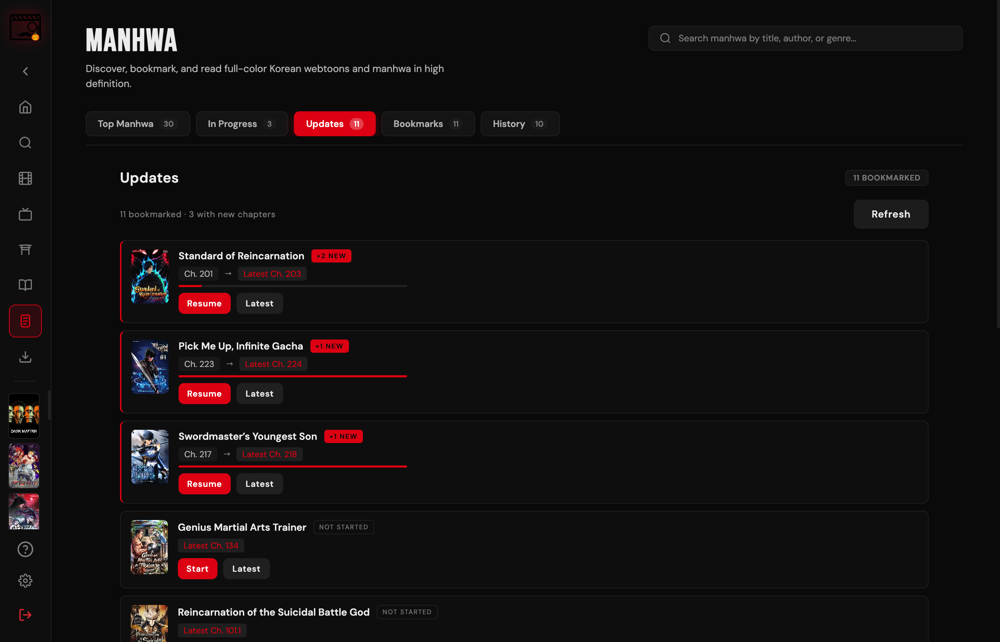

# Sixfaced

A cross-platform Electron desktop app to stream and download movies, TV series and anime — with a manga/manhwa reader, bookmark-based update tracking, and a local library.

[](https://github.com/Genesis-Z-R/sixfaced/releases)
[](LICENSE)


> **Sixfaced** is a personal fork of [Streambert](https://github.com/truelockmc/streambert) by **truelockmc**, rebranded and extended.
> Both projects are free software under the GNU GPL v3. See [NOTICE](NOTICE) for attribution and a list of changes.

---

## Features

- **Streaming** — movies, series and anime via VidSrc, Videasy and VidKing, with TMDB metadata.
- **Anime** — AllManga sources with AniList metadata, dub/sub selection, and intro/outro skip timings.
- **Manga & Manhwa** — search, bookmarks and a full-screen reader with vertical webtoon and paginated modes, plus exact page-level resume.
- **Updates** — a tab in Manga, Manhwa, Series and Anime that compares every bookmarked title's current chapter/episode with the latest release, so you can see what you are behind on before opening anything.
- **Downloads** — yt-dlp/ffmpeg managed by the app, a two-slot download queue, concurrent fragments, resumable parts, verified remuxes and in-app playback.
- **Subtitles** — search, download and attach subtitles (SubDL / Wyzie).
- **Library** — history, bookmarks, progress, resume playback and scheduled backups.
- **Interface** — themes and accent colours, custom home layout, gamepad navigation, keyboard shortcuts.
- **No telemetry** — no account, no analytics, no central backend.



---

## Sources

| Purpose | Service |
|---|---|
| Metadata, posters, ratings, episode data | [TMDB](https://www.themoviedb.org/) |
| Movies & series streams | VidSrc, Videasy, VidKing |
| Anime streams / metadata | AllManga, [AniList](https://anilist.co/) |
| Manga & manhwa | MangaPill, Asura Scans, ComicK |
| Subtitles | SubDL, Wyzie |
| App updates | GitHub Releases |

Sixfaced has no backend of its own. The TMDB token is stored with the OS keychain (`safeStorage`) and never leaves your machine.

---

## Requirements

**To run a release build**

- A free TMDB API Read Access Token — see [tmdb-tutorial.md](tmdb-tutorial.md).
- No manual downloader setup: on the first download the app uses `yt-dlp`/`ffmpeg` from your `PATH` if present, otherwise it fetches pinned, checksum-verified builds into its profile (about 120 MB, once).

**To build from source**

- [Node.js](https://nodejs.org/) **>= 22.12** and npm.

---

## Installation

On first launch you are asked for your TMDB Read Access Token. It is saved locally and only needs to be entered once.

### macOS

Download `Sixfaced-*-universal.dmg` from [Releases](https://github.com/Genesis-Z-R/sixfaced/releases), open it and drag **Sixfaced** into Applications.

> Release builds are ad-hoc signed, not notarised. If macOS refuses the first launch, right-click the app → **Open**, or allow it in **System Settings → Privacy & Security**.

### Windows

Download `Sixfaced Setup *.exe` from Releases and run the installer.

### Linux

Download the `.deb`, `.rpm`, `.pacman` or `.AppImage` from Releases.

```bash
# Debian / Ubuntu
sudo dpkg -i sixfaced_*_amd64.deb

# Fedora / RPM
sudo rpm -i sixfaced-*.x86_64.rpm

# Arch Linux
sudo pacman -U sixfaced-*.pacman

# AppImage
chmod +x Sixfaced-*.AppImage && ./Sixfaced-*.AppImage
```

> On Arch, `libxcrypt-compat` may be required: `sudo pacman -S libxcrypt-compat`.

---

## Downloads

Downloads need no setup. The first time you download something, Sixfaced resolves a downloader:

1. If `yt-dlp` and `ffmpeg` are already on `PATH` (or in the usual Homebrew locations), they are used as-is.
2. Otherwise pinned builds are fetched once into `<profile>/bin`, verified against hard-coded SHA-256 hashes, and made executable. Nothing runs before verification.
3. The destination defaults to `~/Downloads/Sixfaced`; you can change it in the download dialog.

When the player requests a manifest, Sixfaced captures the URL together with the `Referer`, `Origin`, `Cookie` and `User-Agent` the player used, then sends exactly those headers to yt-dlp — tokenized CDNs reject a synthesized Referer. The manifest is preflighted before queueing, so an expired or blocked link fails immediately with the HTTP status instead of starting a doomed download. Up to two downloads run at once and the rest wait in a persisted queue; queued, interrupted and failed items survive a restart and can be retried without re-downloading completed fragments. Transfers use eight concurrent fragments, resumable `.part` files and ffmpeg/ffprobe for remuxing and metadata. Failure logs are kept in the profile under `logs/downloads/`. Progress, speed, ETA and the final path are reported back to the UI.

---

## Building from source

```bash
git clone https://github.com/Genesis-Z-R/sixfaced.git
cd sixfaced
npm install

npm start          # build the renderer and launch Electron
npm run dev        # rebuild the renderer in watch mode
npm test           # unit tests (node:test)
npm run lint       # ESLint: undefined identifiers, invalid hooks
```

Packaging (output in `dist/`):

```bash
npm run dist:mac      # universal DMG
npm run dist:win      # NSIS installer
npm run dist:linux    # deb, rpm, pacman, AppImage
```

A Developer ID certificate is required for a signed and notarised macOS build. Without one, electron-builder skips signing and the app has to be opened manually the first time.

---

## How updates work

Sixfaced checks **only** `github.com/Genesis-Z-R/sixfaced`; there is no third-party update server.

1. On startup — when **Settings → Automatically check for updates** is enabled — the app calls the GitHub Releases API and selects the newest release that is neither a draft nor a pre-release.
2. The running version (from `package.json`) is compared with the release tag using a strict `x.y.z` comparison. A repository without releases is reported as “up to date”, not as an error.
3. If a newer release exists, a banner appears. **Settings → Check for Updates** shows the changelog and the available installer for your platform.
4. Downloading happens in the main process and is restricted to `github.com/Genesis-Z-R/sixfaced/releases/download/` plus GitHub's asset redirect hosts. If the release publishes `<asset>.sha256`, the checksum is verified and a mismatch discards the download.
5. Installation is platform-specific: `.dmg` is opened in Disk Utility for you to drag across, `.exe` launches the NSIS installer, `.deb`/`.pacman` go through the system installer, and `.AppImage` is swapped in place. Where the installer supports it, the app relaunches itself afterwards.

Nothing is downloaded or installed automatically — the check is read-only until you press **Install**.

---

## Data, backups and migration

| OS | Profile folder |
|---|---|
| macOS | `~/Library/Application Support/Sixfaced` |
| Windows | `%APPDATA%\Sixfaced` |
| Linux | `~/.config/Sixfaced` |

The profile also contains a `bin/` folder with the managed yt-dlp/ffmpeg/ffprobe tools (~120 MB) and a `logs/downloads/` folder with retained failure logs.

- **Backups:** Settings → Backup exports/imports a JSON file and can schedule automatic backups to `~/Documents/Sixfaced/`.
- **Upgrading from Streambert:** on first launch Sixfaced copies the old `streambert` profile (library, history, progress, downloads) into the new folder. The macOS keychain entry is app-scoped, so the TMDB token has to be entered once after the rename.

---

## Project structure

```
├── index.html                  # renderer entry (CSP lives here)
├── index.js                    # Electron main process
├── preload.js                  # contextBridge API for the renderer
├── player-preload.js           # injected into player webviews
├── popout-preload.js           # picture-in-picture window chrome
├── eslint.config.mjs
├── src/
│   ├── App.jsx                 # shell: navigation, history, settings, update banner
│   ├── components/             # MediaCard, MangaReader, UpdatesFeed, modals…
│   ├── ipc/                    # main-process modules
│   │   ├── allmanga.js         # anime resolver + local player server
│   │   ├── downloads.js        # download queue and child processes
│   │   ├── manga.js            # MangaPill provider
│   │   ├── manhwa.js           # Asura / ComicK provider
│   │   ├── player.js           # playback, updater, window controls
│   │   ├── downloadTools.js    # yt-dlp/ffmpeg resolution + provisioning
│   │   ├── storage.js          # secure store + scheduled backups
│   │   ├── subtitles.js        # subtitle search/download
│   │   ├── fsSafe.js           # atomic JSON persistence
│   │   ├── netGuard.js         # SSRF protection for proxied requests
│   │   ├── pathSafety.js       # path containment for deletes
│   │   └── lruCache.js         # bounded image cache
│   ├── pages/                  # Home, MediaHub, Movie, TV, Manga, Manhwa…
│   ├── styles/                 # global.css + bundled fonts
│   └── utils/                  # api, storage, updates, readingProgress, updatesCalc…
├── tests/                      # node:test suites
├── build/                      # icon source and .icns
├── public/                     # app icon, logo, installer assets
└── screenshots/
```

---

## Contributing

Bug reports and pull requests are welcome. Keep changes focused, run `npm run lint && npm test` before opening a PR, and describe the user-visible change. See [CONTRIBUTING.md](CONTRIBUTING.md).

---

## License

GNU General Public License v3.0 — see [LICENSE](LICENSE) and [NOTICE](NOTICE).
Sixfaced is a modified fork of [Streambert](https://github.com/truelockmc/streambert); the original copyright notices are preserved.

---

## Privacy

Sixfaced collects no telemetry and requires no account. Outbound requests are limited to the providers listed above and the GitHub release check. Those third parties may log your IP; the app's ad/tracker blocking applies to the player webviews.

## Legal

This application is for **educational and personal use only**.

- Sixfaced does not host, store, or distribute any copyrighted content.
- All content is sourced from third-party providers; the app acts as an aggregator.
- Users are solely responsible for ensuring they have the right to access any content in their jurisdiction.
- The developer does not endorse or encourage copyright infringement.
- Any legal issues should be directed at the actual content providers.
