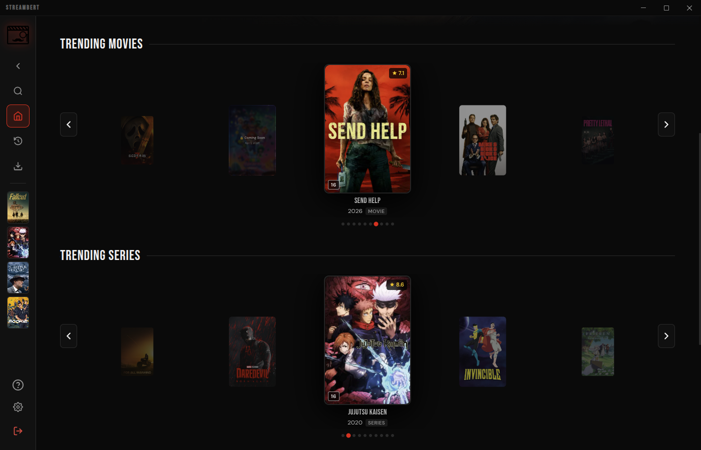
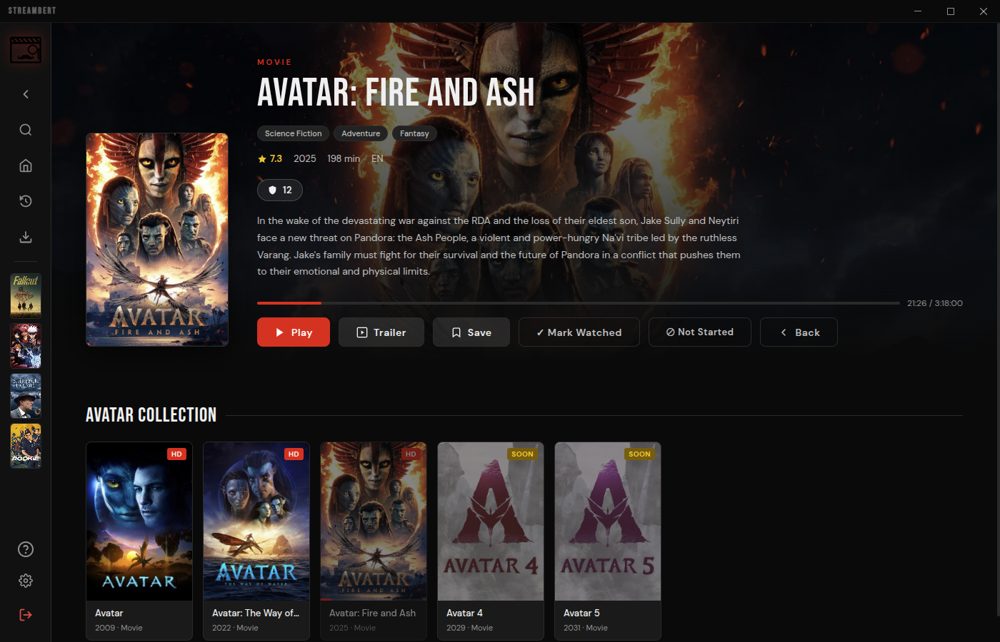
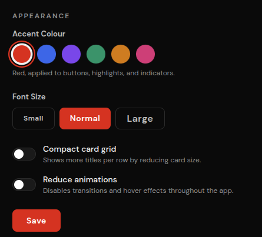

# Sixfaced
A cross-platform Electron desktop app to stream and download movies, TV series and anime — with a manga/manhwa reader, bookmark update tracking, and a local library.

[](https://github.com/Genesis-Z-R/sixfaced/releases)
[](LICENSE)


> **Sixfaced** is a personal fork of [Streambert](https://github.com/truelockmc/streambert) by **truelockmc**, rebranded and extended.
> Both projects are free software under the GNU GPL v3. See [NOTICE](NOTICE) for attribution and a list of changes.

[Installation](#requirements)

## Why Sixfaced?
- 🎦 **Streaming:** Stream any Movie, Anime or TV Series from around the World.
- 📥 **Downloading:** Download anything you want to watch.
- 📃 **Subtitles:** Download and manage Subtitles.
- ⚙️ **Customizability:** Customize the Interface and Features to your unique needs.
- 📚 **Library:** Track what you watched, save stuff you want to watch and manage your Downloads.
- ✨ **Trending:** Discover new things to Watch every Day.
- 🛡️ **Privacy:** Completely Ads and Tracker free, forever.
- ⚡ **Speed:** Stream faster than any Browser can, download with multithreading.









---
## Streaming
The Application mainly gets Video Streams from VidSrc (you can also Stream from videasy and vidking). <br></br>
It fetches Information for Images, Info Texts, Search and Homepage from [tmdb](https://www.themoviedb.org/).

---

## Downloading
You can download those Video Streams because the Program sources Links to their .m3u8 Playlist Files ([similar to this Browser Extension](https://addons.mozilla.org/en-US/firefox/addon/m3u8-link-finder/)). <br></br>
Once you click 'Download' these Links are used to download the Full Movie/TV Episode using [this Program](https://github.com/truelockmc/vid-dl-cli-only). You can then watch them In-App or take the Files on any Storage Medium you want.

---

## Anime
You can also watch Anime, the App checks if a Movie or Series is an Anime and then sources its Metadata from [AniList](https://anilist.co/) instead of [tmdb](https://www.themoviedb.org/). <br></br>
Media Files for Animes are scraped from AllManga.to (i stole this mechanic from [ani-cli](https://github.com/pystardust/ani-cli)). The App directly gets .mp4 Files and doesnt evem show you the AllManga website, you can also download these Files, just like any other Content.


## Requirements

- [Node.js](https://nodejs.org/) (>=22.12.0) installed (only if you aren't using [prebuilt Binaries](https://github.com/Genesis-Z-R/sixfaced/releases/latest))
- A free TMDB API Read Access Token ([Guide on how to get one](tmdb-tutorial.md))
- For downloading, [this Program](https://github.com/truelockmc/vid-dl-cli-only/releases/latest) somewhere on your PC and [ffmpeg](https://ffmpeg.org/download.html) installed

---
## Installation
On first launch you'll be prompted to enter your TMDB API key. ([Guide on how to get one](tmdb-tutorial.md))
It's saved locally, you only need to do this once.

### Linux, Manual (.deb / .AppImage / .pacman)

Download the latest `.deb` `.pacman` or `.AppImage` from the [Releases](https://github.com/Genesis-Z-R/sixfaced/releases/latest) page.
```bash
# .deb
sudo dpkg -i streambert_*.deb

# Arch Linux (.pacman)
sudo pacman -U streambert-*.pacman

# .AppImage (you can also do it with Gearlever)
chmod +x Sixfaced-x64.AppImage && ./Sixfaced-x64.AppImage
```

### Windows

Download the latest `Sixfaced Setup *.exe` from the [Releases](https://github.com/Genesis-Z-R/sixfaced/releases/latest) page and run it.

### macOS
Download the latest `Sixfaced-*-universal.dmg` from the [Releases](https://github.com/Genesis-Z-R/sixfaced/releases/latest) page, open it and drag Sixfaced to your Applications folder.

---


## Building from Source
1. Install dependencies:
```bash
npm install
```
2. Build
```bash
npm run dist:win   
```
or
```bash
npm run dist:linux 
```
or (for Arch Linux)
```bash
npm run dist:arch
```
or (for an AppImage only)
```bash
npm run dist:appimage
```
or (for a .deb only)
```bash
npm run dist:deb
```
or (for a .rpm only)
```bash
npm run dist:rpm
```
or (for macOS)
```bash
npm run dist:mac
```
or (build all platforms at once)
```bash
npm run dist
```

> [!IMPORTANT]
> If you are building/installing on Arch Linux and encounter errors, you may need these libraries:
> - **libcrypt.so.1 error:** `sudo pacman -S libxcrypt-compat`
> - **http-parser dependency error:** `yay -S http-parser` (from AUR)

## License
This project is open-source software licensed under the GNU General Public License v3.0 [(GPL-3.0)](LICENSE).

Forks may be created but they MUST stay open-sourced.

## Contributing
Everyone is welcome to contribute to this project.
Before contributing please make sure to read the [Contributing Guidelines](CONTRIBUTING.md) and act accordingly.

## Privacy Disclaimer
Sixfaced itself does not collect ANY data. There is no centralized service which the app relies on.
However, the streaming sources and github (for downloading updates in-app) may still collect your data.

Sixfaced has built-in tracker/- and adblocking, but obviously that is not perfect.

## Legal Disclaimer

**IMPORTANT: This application is for educational and personal use only.**

- Sixfaced does not host, store, or distribute any copyrighted content
- All content is sourced from third-party providers and websites
- Users are solely responsible for ensuring they have legal rights to access any content
- The developer does not endorse or encourage copyright infringement
- Users must comply with all applicable laws in their jurisdiction
- Any legal issues should be directed to the actual content providers
- This app functions as a search engine aggregator only
- No copyrighted material is stored on my side

## Legal Notice

This application is provided "as is" for educational purposes. The developer:
- Does not claim ownership of any content
- Does not profit from copyrighted material in any way
- Does not control third-party content providers
- Encourages users to support content creators through legal means


<details>
    <summary>Project Structure</summary>
    
```
Project Root
├── index.html
├── index.js
├── package.json
├── preload.js
├── vite.config.js
├── LICENSE
├── README.md
├── public
│   ├── icon.png
│   ├── installer-sidebar.bmp
│   └── logo.svg
├── screenshots
│   ├── adblock.png
│   ├── anime.png
│   ├── api-settings_tmdb.png
│   ├── application_tmdb.png
│   ├── download.png
│   ├── icon.png
│   ├── movie.png
│   ├── personal-use_tmdb.png
│   ├── series.png
│   ├── setup.png
│   ├── signup_tmdb.png
│   ├── subs.png
│   ├── token_tmdb.png
│   └── trending.png
└── src
    ├── App.jsx
    ├── main.jsx
    ├── components
    │   ├── BlockedStatsModal.jsx
    │   ├── CloseConfirmModal.jsx
    │   ├── DownloadModal.jsx
    │   ├── ErrorBoundary.jsx
    │   ├── Icons.jsx
    │   ├── KeyboardShortcutsModal.jsx
    │   ├── MediaCard.jsx
    │   ├── SearchModal.jsx
    │   ├── SetupScreen.jsx
    │   ├── Sidebar.jsx
    │   ├── SubtitleDownloaderModal.jsx
    │   ├── TrailerModal.jsx
    │   ├── UpdateModal.jsx
    │   └── WindowTitlebar.jsx
    ├── ipc
    │   ├── allmanga.js
    │   ├── blockStats.js
    │   ├── downloads.js
    │   ├── player.js
    │   ├── storage.js
    │   └── subtitles.js
    ├── pages
    │   ├── DownloadsPage.jsx
    │   ├── HomePage.jsx
    │   ├── MediaHubPage.jsx
    │   ├── MoviePage.jsx
    │   ├── SettingsPage.jsx
    │   └── TVPage.jsx
    ├── styles
    │   ├── global.css
    │   └── fonts
    │       ├── bebas-neue-regular.woff2
    │       ├── dm-sans-300.woff2
    │       ├── dm-sans-500.woff2
    │       ├── dm-sans-600.woff2
    │       └── dm-sans-regular.woff2
    └── utils
        ├── ageRating.js
        ├── aniSkip.js
        ├── api.js
        ├── appearance.js
        ├── backup.js
        ├── episodeMappings.js
        ├── homeLayout.js
        ├── storage.js
        ├── subtitles.js
        ├── updates.js
        ├── useBlockedStats.js
        └── useRatings.js
```
</details>
